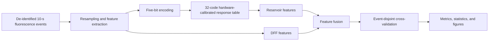

# Reproducibility guide

This guide defines which parts of the study can be reproduced from the public package and which parts require new biological or device experiments.

## Workflow

## Public file inventory

- `103_raw_10s_segments_only.zip` (Release asset): 103 de-identified 10-s event segments, each retaining its time axis and original ΔF/F values without feature extraction.
- `fig6_reproducibility/`: preprocessing, five-bit encoding, response-table mapping, feature construction, model fitting, evaluation, and figure-generation scripts.
- `Fig6_S12_S13_reproducibility/`: scripts and source tables for the Figure 6, Figure S12, and Figure S13 analyses.
- `models/` and model metadata: serialized ExtraTrees estimators, feature order, class mapping, and preprocessing metadata.
- `device_response/`: experimentally measured four-channel response-table data used as the hardware-calibrated lookup table.
- `DFT_reproducibility_package_v1.zip`: atomic structures, calculation inputs, vacancy structures, NEB configurations, available outputs, and charge-density files supporting the first-principles analysis.
- `requirements.txt`, `requirements-lock.txt`, `environment.yml`, `Dockerfile`, and `ENVIRONMENT.md`: software environment specifications.
- `validate_clean_environment.py`: deterministic environment and output validation.

## Data dictionary and units

| Variable | Definition | Unit or convention |
|---|---|---|
| `time` | Sampling time in a released fluorescence event | seconds |
| `dff` | Fluorescence signal used for computational analysis | ΔF/F, dimensionless |
| `z` | Scalar encoding variable derived from the resampled event | ΔF/F, dimensionless |
| `code` | Quantized five-bit input level | integer 0–31 |
| `SMP1`–`SMP4` | Four calibrated device-response channels | current or conductance units as recorded in the source table |
| `label` | Sham/SNI event class | categorical |
| `prediction` | ExtraTrees output class | categorical |

The released source segments retain their time axis and original ΔF/F values. No raw current or voltage value is silently converted between units; the source files and figure scripts define the corresponding electrical units explicitly.

## Software and expected outputs

The canonical environment is specified by the tagged release and includes CPython 3.12.10, NumPy 2.3.4, pandas 2.3.3, SciPy 1.16.2, scikit-learn 1.9.0, matplotlib 3.10.7, joblib 1.5.3, and openpyxl 3.1.5. The clean-environment validation script checks package versions, model loading, deterministic examples, and the reported classification outputs. The expected event-level results are approximately 0.8544 for DFF-only, 0.7184 for RC-only, and 0.8641 for the fused DFF+RC workflow.

## Reproducibility scope

**Reproducible from public files.** The released de-identified events support resampling, DFF feature extraction, five-bit encoding, response-table lookup, reservoir-feature generation, feature fusion, ExtraTrees fitting, event-disjoint evaluation, statistical analysis, and regeneration of the released computational figures.

**Controlled-access material.** Original non-de-identified animal records and metadata linking events to individual animals, sessions, or experimental identifiers are not publicly distributed. Requests can be directed to the corresponding author and are subject to institutional and applicable animal-data governance requirements.

**Requires independent experiments.** New animal surgery, viral expression, fiber implantation, behavioral stimulation, fiber-photometry acquisition, device fabrication, and electrical measurements cannot be reproduced from software files alone. Independent replication therefore requires a new approved animal experiment and new device measurements. The public response table and electrical source files are the measurements used in this article, not a substitute for an independent physical replication.

## Known restrictions

The public package is intended to reproduce the computational analysis performed for this manuscript. It does not claim that an independent investigator can recreate the original biological recordings or device responses without repeating the corresponding experiments. Raw animal recordings are restricted, and the released event files are de-identified for reproducibility of the reported software workflow.
